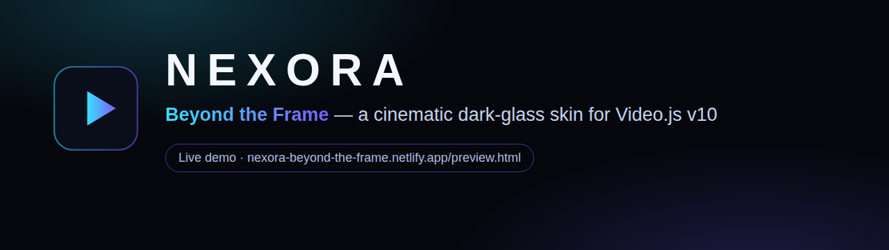
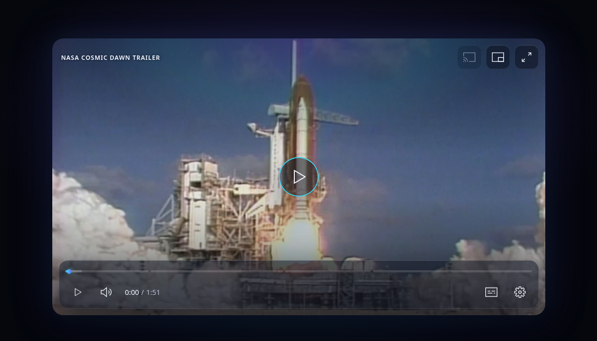
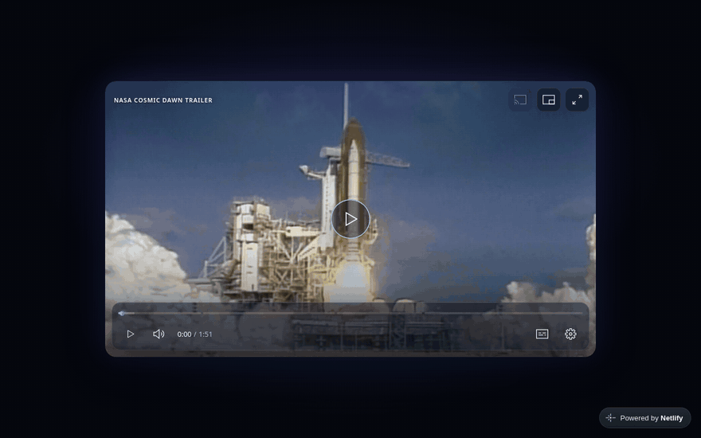
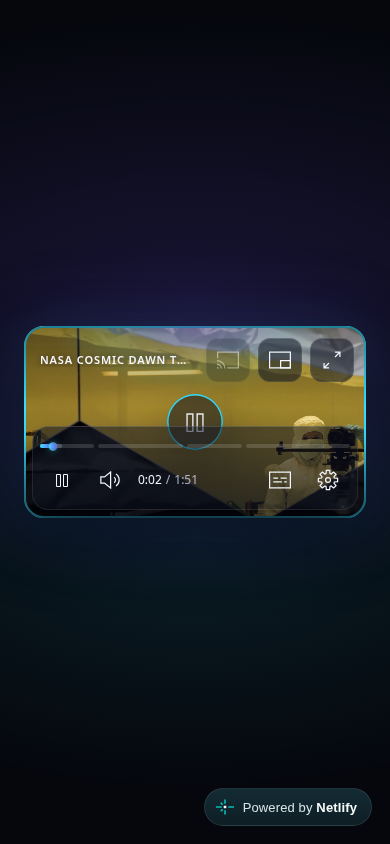
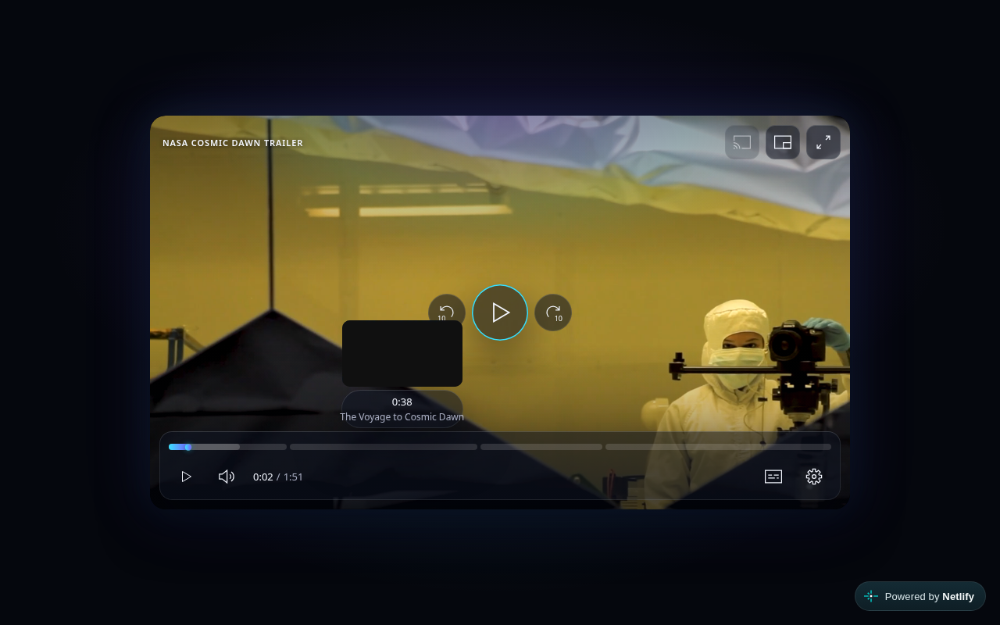
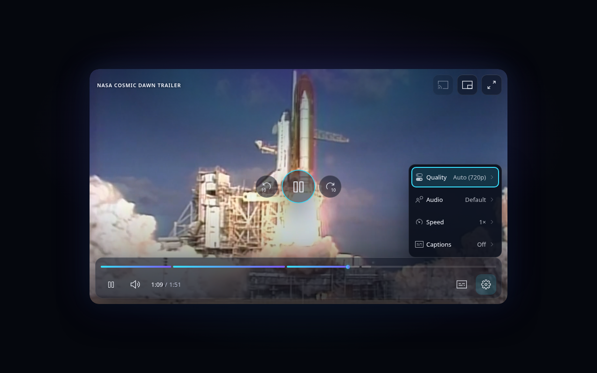

<p align="center">
  
</p>

<p align="center">
  
</p>

<h1 align="center">NEXORA</h1>

<p align="center"><strong>Beyond the Frame</strong> — a cinematic dark-glass skin for Video.js v10.</p>

<p align="center">
  <a href="https://nexora-beyond-the-frame.netlify.app/preview.html"><strong>▶ Live demo</strong></a> ·
  <a href="#installation">Installation</a> ·
  <a href="#customization">Customization</a> ·
  <a href="ARCHITECTURE.md">Architecture</a> ·
  <a href="CONTRIBUTING.md">Contributing</a>
</p>

<p align="center">
  
  
  
</p>

<p align="center">
  
</p>

<p align="center">
  
</p>

<p align="center">
  
</p>

## Overview

NEXORA is a complete custom skin for the [Video.js v10](https://videojs.com/) HTML
renderer (`@videojs/html`). It replaces the default player chrome with a cinematic,
dark-glass interface: a floating control dock, an aurora-gradient timeline with
chapter markers and storyboard thumbnail previews, glass menus, and a large centre
play disc — while keeping every control keyboard-operable, labelled, and usable
over bright and dark footage.

The skin itself is plain HTML, CSS and TypeScript in `src/`. The repository also
ships the preview workbench under `apps/preview/` — a small React + Vite app that
runs the skin against a real Mux-hosted video with chapters and English/Japanese
subtitles, and is the fastest way to evaluate and customise it.

## Why NEXORA exists

Default player UI is functional but forgettable, and most custom skins trade
accessibility for looks. NEXORA was built to prove a Video.js v10 skin can be:

- **Cinematic** — a deliberate visual identity (deep-space glass, aurora accent
  gradient `#38e1ff → #7c5cff`) instead of a recolored default theme.
- **Practical** — chapters, storyboard previews, quality/audio/subtitle menus and
  casting controls where viewers expect them.
- **Accessible** — full keyboard operation, visible focus, ARIA labelling, a live
  status announcer, and reduced-motion support are part of the design, not an
  afterthought.

## Key features

- Cinematic dark-glass control dock with ambient glow, floating over the video
- Aurora-gradient timeline with buffered region, chapter markers and chapter titles
- Storyboard thumbnail previews while scrubbing or hovering the timeline
- Settings menu with playback speed, quality, audio and subtitle selection
- Captions support with a dedicated captions style layer
- Volume popover, seek buttons, time display, title bar
- Picture-in-picture, fullscreen, AirPlay and Cast buttons (where the platform supports them)
- Centre play disc and a buffering indicator that match the visual language
- Error dialog styled to the skin, with a dialog system shared by menus
- Hotkeys for common actions, plus a polite live-region status announcer
- Responsive layout that reflows to a touch-friendly mobile arrangement
- `prefers-reduced-motion` support that calms non-essential animation

<p align="center">
  <br>
  <em>Timeline with storyboard preview</em>
</p>

<p align="center">
  <br>
  <em>Glass settings menu</em>
</p>

## Interactive controls

| Control | What it does |
| --- | --- |
| Play / pause button & centre disc | Toggle playback; the disc appears when paused |
| Time slider | Seek; shows buffered range, chapters and a storyboard preview with the hovered time |
| Volume button + popover slider | Mute/unmute and fine volume control |
| Time display | Current time / duration; click behaviour follows Video.js conventions |
| Settings menu | Playback speed, quality, audio tracks and subtitles |
| Captions | Toggle and style captions (demo includes English and Japanese tracks) |
| PiP / Fullscreen | Picture-in-picture and fullscreen, with an `f` hotkey for fullscreen |
| AirPlay / Cast | Platform casting where supported by the browser and media |
| Keyboard | Tab through every control in visual order; arrow keys adjust sliders; standard Video.js hotkeys apply |

## Responsive design

The same skin serves desktop and mobile. On narrow viewports the dock condenses,
secondary actions move behind the settings menu, tap targets stay thumb-sized,
and the layout keeps title, timeline and primary actions readable — see the
mobile screenshot above.

## Accessibility

- Every interactive element is keyboard-operable with a visible focus outline
- Controls carry accessible names; menus can be exited with `Escape`
- A live-region announcer reports state changes (play, pause, seek, volume)
- Text and controls remain legible over bright and dark footage (scrim + glass)
- `prefers-reduced-motion` disables non-essential transitions
- Automated checks on the live demo: axe-core reports 0 violations

More detail: [docs/accessibility.md](docs/accessibility.md).

## Technology stack

| Layer | Technology |
| --- | --- |
| Player | Video.js v10 — `@videojs/html` 10.4.0 |
| Demo media | `@videojs/mux-video` 10.4.0, video hosted on Mux |
| Skin | HTML + CSS (custom properties, layered style sheets) + TypeScript |
| Preview workbench | React 19, Vite 8, Tailwind CSS 4, TypeScript |
| Build | Vite (`npm run build`), type-checking via `tsc --noEmit` |

## Architecture

Short version: `src/video/skin.ts` composes the `@videojs/html` UI components,
`src/video/skin.html` declares the control layout, and `src/video/skin.css` plus
the layered sheets in `src/styles/` carry the visual system (base, video,
captions and theme tokens). The full picture is in
[ARCHITECTURE.md](ARCHITECTURE.md).

## Installation

Prerequisites: Node.js 20+ and npm.

```bash
git clone https://github.com/liyansdigital/nexora-beyond-the-frame.git
cd nexora-beyond-the-frame
npm install
```

## Quick start

```bash
npm run dev       # start the preview workbench (Vite dev server)
npm run build     # production build into dist/
npm run preview   # serve the production build locally
npm run typecheck # TypeScript check without emitting
```

Open the dev-server URL and press play — the workbench loads the skin with a
chaptered, subtitled demo video.

## Configuration

The workbench reads its options from the URL and its options panel (scenario,
captions, reduced motion and layout toggles are built in). The skin itself needs
no configuration file and no environment variables — see `.env.example`.

## Usage

NEXORA targets the Video.js v10 HTML renderer. The reference integration is the
workbench itself: `apps/preview/src/frame/player.ts` wires the media element,
while importing the skin is a matter of loading the skin entry
(`src/video/skin.ts`) with your player so its components and styles register
before the player UI is created. Treat `apps/preview/` as the living example.

## Customization

Design tokens live in `src/styles/themes/` — most importantly the aurora accent
gradient (`--nexora-accent-gradient`) and the deep-space surfaces. Restyle by
overriding tokens and the theme layer rather than editing component markup.
See [docs/customization.md](docs/customization.md).

## Project structure

```
nexora-beyond-the-frame/
  README.md            This file
  ARCHITECTURE.md      How the skin is put together
  CHANGELOG.md         Release history
  CONTRIBUTING.md      How to contribute
  src/
    video/             skin.ts (composition), skin.html (layout), skin.css
    styles/            base, video, captions and theme layers
    skin.css           skin entry stylesheet
  apps/preview/        React + Vite workbench and live demo
  assets/              Logo, banners and screenshots used in this README
  docs/                Customization, accessibility, deployment, troubleshooting
  .github/             Issue/PR templates and CI workflow
```

## Browser compatibility

NEXORA runs wherever the Video.js v10 HTML renderer runs: current Chrome, Edge,
Firefox and Safari. AirPlay is Safari-only and Cast requires Chrome, as with
Video.js itself.

## Performance considerations

The skin is CSS and markup only — no animation frameworks, no runtime theming
engine. Animation leans on `transform` and `opacity`, and the whole skin layer
adds no extra network requests beyond the styles and sprites the player loads.

## Known limitations

- Built for the `@videojs/html` renderer of Video.js v10; it is not a Video.js 7/8 theme.
- Storyboard previews need a storyboard (thumbnail) track on the media, as in the demo.
- The demo video is a trailer hosted on Mux for evaluation; bring your own media for production use.

## Roadmap

- Additional accent themes beyond the default aurora palette
- A light-glass variant with the same control set
- Published package for direct installation once the API settles

## Contributing

Contributions are welcome — please read [CONTRIBUTING.md](CONTRIBUTING.md) and
the [Code of Conduct](CODE_OF_CONDUCT.md). For bugs and feature requests, use
the issue templates.

## License

Licensed under the [Apache License 2.0](LICENSE).

## Credits

- [Video.js](https://videojs.com/) and the `@videojs/html` component library
- [Mux](https://www.mux.com/) for demo video hosting
- Demo footage: NASA "Cosmic Dawn" trailer
- Built for the Video.js Skins Design Challenge by Mux

## Author

**Vikas Kumar Meena** — designer & developer, LIYANS DIGITAL

- GitHub: [@liyansdigital](https://github.com/liyansdigital)
- Website: [vikasdigital.cv](https://vikasdigital.cv)
- Contra: [liyanspaperlab](https://contra.com/liyanspaperlab)

Questions and support: see [SUPPORT.md](SUPPORT.md).
